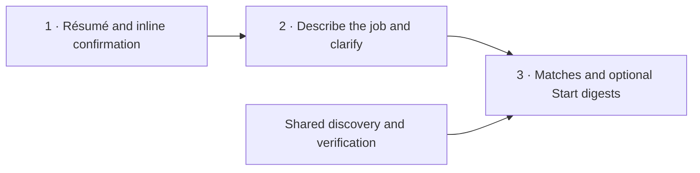

# Onboarding to first digest

Decisions: ../decisions.md
Retired: J4.S2.c2, J4.S4, J4.S4.c1, J4.S4.c2, J4.S4.c3, J4.S4.c4, J4.S4.c5, J4.S4.c6, J4.S4.c7, J6.S1.c3, J6.S1.c4, J6.S2.c2
Scope: D1, D3–D19, D22–D24, D27, D28, D30, D32–D38, D40–D43, D46–D49, D52, D53, D55, D58–D64, D66–D71, D74, D76, D84–D86, D91, D92, D95–D124

Markdown is the editable source, migrated from YAML on 2026-10-26 using agentic-skills at 9ec781b.
This is a draft. Accepted policy is distinct from build approval and implementation evidence.
Test links in [verification.json](../verification.json) name existing unit tests; they do not prove the complete journey.

Clerk sign-in precedes these three screens. J2 and J3 are states on the same
Résumé screen; J4 uses the search screen; J5 uses the matches screen. Optional
profile edits and schedule changes stay inline. Journey steps are states and
system actions, not additional required pages.

## Actors

- subscriber: Job-seeking subscriber
- operator: Product owner operating the dev deployment

## Goals

- C1 subscriber: Sign in and reach the right onboarding stage → J1
- C2 subscriber: Provide a resume or enter a profile manually → J2
- C3 subscriber: Confirm the extracted profile at a glance on the résumé screen → J3
- C4 subscriber: Describe the desired job, clarify missing eligibility and optionally start digests after preview → J4, J5
- C5 subscriber: Preview an initial ranked digest immediately → J5
- C6 operator: Build and verify the shared job catalogue from a seed employer set → J6
- C7 subscriber: Receive a test email digest → J7
- C8 subscriber: Resume onboarding after closing the tab or losing a response → J2, J3, J4
- C9 subscriber: Receive digests automatically on a recurring schedule in their own timezone → unresolved: Deferred to stage 3. Policy is now accepted under D50, D74, D75 and D76; the journey is not yet mapped
- C10 subscriber: Pause, resume or unsubscribe from delivery → unresolved: Accepted as policy under D46 but not mapped in the thin flow. J7.S1 reads the states; the subscriber-facing controls arrive in stage 3
- C11 subscriber: Mark a job interested, not relevant, already applied or already contacted → unresolved: Accepted as policy under D44 but deferred to stage 4. J5.S3 consumes these marks once they exist
- C12 subscriber: See a relevant verified hiring contact for a recommendation → unresolved: Deferred until verification and ranking are trustworthy under D73
- C13 subscriber: Delete their account and stored data → unresolved: Retention is accepted under D59; the deletion journey is not yet mapped
- C14 operator: Expand employer coverage beyond the seed set → J6
- C15 subscriber: Run a natural-language search, review its interpretation and optionally save criteria → unresolved: Onboarding is mapped in J4–J5; returning-subscriber one-off searches and explicit updates to existing digest criteria under D91 still need mapping
- C16 subscriber: Enter application history and inspect possible repeats or reapplication restrictions → unresolved: D18, D108 and D112 are accepted; history entry is not mapped
- C17 subscriber: Use location-specific salary and sponsorship constraints → J4, J5
- C18 operator: Trace shortfalls and resource usage for each run → J5, J6

## Onboarding questions

These controls refine the natural-language request on the search screen. Show
only missing, relevant questions; prefill known answers and let the subscriber
correct them. Ranking suggestions are editable, never required. Hard constraints
are not inferred from nationality, résumé address or a job title. The request’s
location groups retain separate eligibility, salary and sponsorship rules.

| Question shown to the subscriber | Input form | When shown / meaning |
|---|---|---|
| What kind of job are you looking for? | One natural-language field with an example | Main search prompt; derive role and location suggestions, then show the interpretation before searching. |
| Which roles interest you? | Suggested, editable role chips | Only if the request has not settled the target roles/job family; suggestions can be accepted or changed. |
| Where and how would you like to work? | Location search plus Remote / Hybrid / On-site | Only for missing work-location or arrangement requirements; support different choices by location. |
| Where will you work remotely from? | Country/city search | When remote is selected without the subscriber’s intended work location; remote never means worldwide. |
| Can you already work in this location? | Already authorised / Need sponsorship / Not sure | Only where authorisation is relevant and unanswered; keep answers per location and preserve Not sure. |
| Do you need the employer to provide relocation support? | Required / Not required | Only where relocation matters; separate this answer from visa sponsorship. |
| Do you have a minimum base salary? | Optional amount, currency, month/year, Must meet / Prefer | May differ by location; explain that base excludes bonus/equity. Must meet follows D113, including undisclosed pay exclusion. |
| Any other preferences? | Collapsed More preferences | Optional industries, company preferences, seniority and other ranking interests; prefill only as editable suggestions. |
| Already applied to some jobs? | Optional action after results | Opens the later history-entry flow; never blocks seeing matches or starting digests. |

Example input: “Remote full-stack roles from India, or Singapore roles with visa
and relocation support.” Interpretation example: “Full-stack · Remote from India;
Singapore · Visa sponsorship required · Relocation support required.” These are
illustrations of user-provided answers, not defaults or presumed qualifications.

Results show “Email me matches daily at 8:00 AM · Up to 10 jobs”, the resolved
local timezone, Change settings and Start digests. Omitted settings use D106’s
defaults. Ask for a valid timezone only when starting email and none is available.

## Observations

Historical findings from 2026-10-21; not refreshed by this document migration.
- O1: eve turns each defineSchedule into a Vercel Cron Job evaluated in UTC, fixed at build time, so a single authored cron cannot express per-subscriber local delivery times. Source: vercel/eve/docs/schedules.mdx@7b8a520 On Vercel
- O2: The eve sandbox receives no process.env, no secrets and no path back to the app runtime; built-in tools execute in the app runtime and proxy into the sandbox. Source: vercel/eve/docs/concepts/security-model.md@7b8a520 Trust boundaries
- O3: The agent-browser eve extension exposes browser__navigate, browser__snapshot, browser__click, browser__fill, browser__find and browser__screenshot, and accepts allowedDomains, contentBoundaries and maxOutputChars. Source: vercel/eve/apps/docs/lib/integrations/data.ts@7b8a520 agent-browser
- O4: Greenhouse, Lever and Ashby each expose an unauthenticated per-employer job board feed with no server-side search, so filtering is client-side. Endpoint shapes are from secondary sources and are not yet verified against primary documentation. Source: https://github.com/Mersetti/ats-job-board-apis@2026-10-21 README endpoints
- O5: eve's documented application-managed scheduling pattern claims due rows under an atomic lease and states that delivery is at least once, so side-effecting work needs application-level idempotency. Source: vercel/eve/docs/patterns/dynamic-scheduling.md@7b8a520 Delivery is at least once
- O6: Every eve session runs as one durable workflow checkpointed at step boundaries, surviving process restarts and redeploys. Source: vercel/eve/docs/concepts/execution-model-and-durability.mdx@7b8a520 Sessions

## Invariants

- I1 (D7, D9, D48): Never: present an opening without recorded verified_open evidence.
- I2 (D17): Never: include an opening already delivered to this subscriber.
- I3 (D13, D16, D42): Never: include a job that fails a subscriber hard constraint.
- I4 (D28, D43): Never: attribute experience or qualifications absent from the confirmed profile.
- I5 (D35): Never: expose a subscriber’s résumé, profile or recommendations to another principal.
- I6 (D22, D46): Never: email without current opt-in or while paused or unsubscribed.
- I7 (D22, D23): Never: send more than one digest for a send idempotency key.
- I8 (D32): Never: act on instructions from external pages or uploaded documents.
- I9 (D11, D12): Never: perform external write actions during research.
- I10 (D109): Always: preserve each opening’s furthest funnel stage and rejection reason or unresolved state.
- I11 (D36, D55, D110): Never: exceed resource caps measured against run counters.

## J1: Sign in and reach onboarding
Actor: subscriber · Exits: onboarding_ready, denied

Checks:

- denied: J1.S1.c2, J1.S1.c3
- invalid: J1.S1.c2, J1.S1.c3
- failed: J1.S1.c4, J1.S1.c5
- repeated: J1.S1.c1, J1.S2

### J1.S1 Authenticate with Clerk (person)
Screen: Sign in · Sees: Clerk sign-in, or service error with retry
Basis: D1, D35, D95
Guards: I5
- c1: When a visitor completes Clerk sign-in: create or load the subscriber record keyed to the verified Clerk user id.
- c2: If a request carries no verified Clerk session: never return any subscriber data.
- c3: If a request supplies a subscriber id that differs from the verified session principal: never act on the supplied id.
- c4: If the identity provider is unavailable: never create or modify a subscriber record.
- c5: When the identity provider is unavailable: leave the visitor unauthenticated and offer a retry.
→ J1.S2 when authenticated
→ exit denied when unauthenticated

### J1.S2 Route to the first incomplete onboarding stage (system)
Basis: D105, D30, D114
- c1: When a signed-in subscriber has no draft or confirmed profile: route them to the resume stage.
- c2: When a signed-in subscriber has a draft profile that is not confirmed: route them to the profile review stage.
- c3: When a signed-in subscriber has a confirmed profile and no saved preferences: route them to the preferences stage.
→ exit onboarding_ready

## J2: Provide a resume
Actor: subscriber · Exits: draft_profile_ready, upload_rejected

Checks:

- denied: J2.S1.c4, I5
- invalid: J2.S1.c2, J2.S1.c3, J2.S3.c2
- failed: J2.S1.c5, J2.S1.c6, J2.S2.c5, J2.S2.c6, J2.S2.c7
- repeated: J2.S1.c7, J2.S2.c8, J2.S2.c9, J2.S2.c10

### J2.S1 Submit a resume file or choose manual entry (person)
Screen: Résumé · Sees: PDF/DOCX upload, manual entry, validation error, or retry
Basis: D47, D35, D59, D95, D96
Guards: I5
- c1: When a size-valid PDF/DOCX is uploaded: store it privately for its subscriber.
- c2: If an upload fails type or size validation: never store the file.
- c3: When an upload fails validation: offer manual entry as a fallback.
- c4: If a principal requests a stored resume they do not own: never return it.
- c5: If object storage is unavailable or rejects the write: never record the upload as stored.
- c6: When object storage is unavailable: keep the subscriber at the resume stage and offer a retry.
- c7: When a subscriber uploads a replacement resume: delete the previously stored upload and retain only the newest one.
→ J2.S2 when file_accepted
→ J2.S3 when manual_entry_chosen
→ exit upload_rejected when validation_failed

### J2.S2 Extract a draft profile from the document (system)
Basis: D28, D32, D43, D95, D96, D97, D114, D115
Guards: I4, I8
- c1: When extraction runs: record for each extracted item the document location it came from.
- c2: When extraction runs: separate professional experience from personal projects, demos and work in progress.
- c3: If the document contains text that instructs the agent: never act on that text.
- c4: If an extracted claim has no supporting location in the document: never include it in the draft profile.
- c5: When extraction yields no usable professional experience: offer manual entry.
- c6: If the extraction model is unavailable or fails: never write a partial draft profile.
- c7: When extraction fails: keep the subscriber at the resume stage and offer a retry.
- c8: When a replacement upload is extracted: replace the subscriber's existing draft profile rather than adding a second one.
- c9: When extraction begins: claim the subscriber's draft profile as its single writer.
- c10: If another extraction holds that claim: never write the draft profile.
- c11: While extraction runs: show progress on the résumé screen.
→ J2.S3 when extraction_unusable
→ exit draft_profile_ready when extraction_usable

### J2.S3 Enter a profile manually (person)
Screen: Manual profile · Sees: Experience and project fields
Basis: D28, D47
Guards: I4
- c1: When a subscriber submits the manual form: build the draft profile from exactly those entries.
- c2: If a field is left empty: never populate it with an inferred value.
- c3: When a subscriber enters an item: require them to classify it as professional experience or as a personal project.
→ exit draft_profile_ready

## J3: Confirm the profile at a glance
Actor: subscriber · Exits: profile_confirmed

Checks:

- denied: J3.S1.c4
- invalid: J3.S2.c5, J3.S2.c6
- failed: open — Q23: profile read/save failure needs a subscriber-visible outcome
- repeated: J3.S3.c1, J3.S2.c5, J3.S2.c6

### J3.S1 Present a one-glance summary of the draft profile (person)
Screen: Résumé · Sees: Experience, skills, projects, Looks right, Edit and source locations
Basis: D28, D35, D104, D105, D114, D115
Guards: I4, I5
- c1: When a draft profile is displayed: mark each item as extracted from the document or manually entered.
- c2: If an item was not extracted from the document: never label it as extracted.
- c3: When an item was extracted: let the subscriber see the document location it came from.
- c4: If the requesting principal does not own the draft profile: never display it.
- c5: When the draft profile is displayed: summarise it on one screen with a single confirm action.
- c6: If the subscriber does not choose to edit: never require them to review items one by one.
- c7: When the résumé summary is ready: show Looks right and optional Edit actions inline.
→ J3.S3 when confirmed
→ J3.S2 when edit_chosen

### J3.S2 Optionally correct, add, remove or reclassify items (person)
Screen: Résumé · Sees: Inline edits, classifications, or stale-edit reload notice
Basis: D28, D98, D105, D115
- c1: When a subscriber edits an item: persist that edit before advancing to the next stage.
- c2: When a subscriber moves an item between professional experience and personal projects: store the new classification.
- c3: When a subscriber removes an item: stop using it for matching.
- c4: When a subscriber submits an edit: require the item version that edit was based on.
- c5: If the submitted item version is stale: never apply that edit.
- c6: When an edit is refused as stale: tell that writer to reload the item before editing it again.
→ J3.S1 when edits_saved
→ J3.S2 when further_edits

### J3.S3 Confirm the profile (system)
Basis: D43, D105, D59
Guards: I4
- c1: When a subscriber confirms: record the confirmed profile with its confirmation timestamp.
- c2: If a profile has not been confirmed: never use it to generate recommendations.
- c3: When a confirmed profile is later edited: require confirmation again before the next digest.
- c4: When the extracted profile is confirmed: delete its uploaded résumé file.
→ exit profile_confirmed

## J4: Describe the job and clarify only missing information
Actor: subscriber · Exits: criteria_ready

Checks:

- denied: J4.S1.c4
- invalid: J4.S1.c3, J4.S2.c11, J4.S5.c2, J4.S6.c7
- failed: open — Q23: preference read/save failure needs a subscriber-visible outcome
- repeated: J4.S5.c4, J4.S5.c5, D91

### J4.S1 Describe the desired job (person)
Screen: Describe the job · Sees: Search prompt, example, role suggestions and More preferences
Basis: D30, D35, D53, D104, D106, D114, D116, D117, D118, D122
Guards: I5
- c1: When the question set is built: omit questions already answered by the confirmed profile or a previous answer.
- c2: When a subscriber selects their target job families: present only the question branches belonging to those families.
- c3: If the subscriber selects no job family: never advance to the next stage.
- c4: If the requesting principal does not own the preferences: never return or modify them.
- c5: When building questions: require only job family and hard constraints the confirmed profile leaves unanswered.
- c6: When a ranking preference can be inferred from the confirmed profile: prefill it.
- c7: If a ranking preference is unanswered: never block the subscriber from advancing.
→ J4.S2 when request_submitted

### J4.S2 Record hard constraints separately from preferences (system)
Basis: D13, D16, D42, D84, D85, D86, D113, D121, D124
Guards: I3
- c1: When work authorisation, sponsorship requirement, country eligibility and exclusions are answered: store them as hard constraints.
- c3: If a hard constraint answer is unknown: never store it as satisfied.
- c4: When a remote preference is recorded: keep any geographic restriction as a hard constraint rather than a preference.
- c5: When recording optional ranking preferences: store target roles, seniority, industries, company stages and nonbinding compensation expectations.
- c6: When constraints vary by location: store each location’s eligibility, sponsorship and salary rules as its own group.
- c7: When a group requires relocation: record relocation sponsorship separately from visa sponsorship.
- c8: When relocation evidence is classified: use offered_explicitly, explicitly_not_offered or not_stated.
- c9: When a location group sets a strict salary floor: store it as a hard constraint.
- c10: When a request is parsed: validate its structured constraints and preferences.
- c11: If a requirement cannot be mapped: flag it for clarification rather than dropping it.
→ J4.S5 when interpretation_available

### J4.S5 Review the interpreted search (person)
Screen: Describe the job · Sees: Plain-language interpretation, editable chips, missing answers and Find matches
Basis: D84, D85, D91, D116, D117, D124
Guards: I3, I5
- c1: When the interpretation is ready: show its roles, locations, hard constraints and ranking preferences before searching.
- c2: If a required answer is missing or unrecognised: ask its clarification before searching.
- c3: When the subscriber changes a chip or answer: update the visible interpretation before applying it.
- c4: When Find matches is selected: use only the interpretation the subscriber has seen.
- c5: When a request is searched again: never change standing digest criteria or grant email opt-in.
→ J4.S6 when required_clarification_remains
→ J4.S2 when interpretation_edited
→ J4.S3 when visible_interpretation_ready_and_find_matches_selected

### J4.S6 Answer relevant follow-up questions inline (person)
Screen: Describe the job · Sees: Only missing eligibility questions with simple choices
Basis: D16, D30, D42, D53, D106, D113, D117, D118, D119, D120, D121, D122
Guards: I3, I5
- c1: When a target role is unclear: offer editable role chips with their job families.
- c2: When work locations or arrangement are missing: offer location search and Remote/Hybrid/On-site choices.
- c3: If remote work lacks a subscriber location: ask where the subscriber will work from.
- c4: When authorisation needs clarification: offer Already authorised, Need sponsorship and Not sure for the relevant location.
- c5: When relocation support matters: offer Required and Not required separately from visa sponsorship.
- c6: When salary is entered: collect amount, currency, month/year and Must meet or Prefer for its location.
- c7: If an answer is Not sure: retain unknown rather than converting it into eligibility.
- c8: If no salary requirement was given: never require salary or optional ranking preferences before searching.
- c9: When More preferences opens: show optional industry, company and other ranking preferences.
→ J4.S2 when clarification_answered

### J4.S3 Prepare optional delivery defaults (system)
Basis: D15, D19, D69, D76, D106, D123, D124
- c1: When no digest size is chosen: default it to 10.
- c2: When a delivery time is chosen: store the local time of day and a separate IANA timezone identifier.
- c3: If a submitted timezone is not a recognised IANA identifier: never save the schedule.
- c4: If a submitted digest size falls outside 3 to 20: never save the schedule.
- c5: When delivery days are chosen: store them as a set of weekdays evaluated in the subscriber's timezone.
- c6: If the effective delivery-day set is empty: never save the schedule.
- c7: When delivery days are omitted: default them to every day.
- c8: When no delivery time is chosen: default it to 08:00 in the subscriber's timezone.
- c9: When the browser reports a recognised IANA timezone: use it as the subscriber's timezone without asking.
- c10: If the browser reports no timezone or an unrecognised one: never save the schedule until the subscriber picks a timezone.
- c11: If a schedule setting has a default: never require the subscriber to answer it during onboarding.
→ exit criteria_ready

Default values are drafts until Start digests. An absent timezone never blocks
the preview; timezone and schedule validation apply before committing email
settings in J5.S7–S8. Omitted settings use defaults; an empty day set is invalid.

## J5: Generate a ranked preview digest
Actor: subscriber · Exits: preview_shown, preview_empty, digests_started

Checks:

- denied: J5.S1.c2, I5
- invalid: J5.S5.c5, J4.S3.c3, J4.S3.c4, J4.S3.c6, J4.S3.c10
- failed: open — Q23: digest-settings save failure needs a subscriber-visible outcome
- repeated: J5.S1.c4, J5.S1.c5, J5.S4.c6, J5.S4.c7, J5.S8.c4, J5.S8.c5

### J5.S1 Select candidates from the shared catalogue (system)
Basis: D4, D37, D100, D109, D110, D124
Guards: I5, I10, I11
- c1: When a preview is requested: read candidate openings from the shared catalogue rather than researching per subscriber.
- c2: If a row holds another subscriber's private profile or recommendation data: never read it into this preview.
- c3: When the catalogue holds no openings for the subscriber's job families: record that as the shortfall reason.
- c4: If a preview run is interrupted before it returns: never resume that run.
- c5: When a preview is requested after an interrupted run: recompute it from the catalogue and the confirmed profile.
- c6: While a preview run executes: record search, fetch, browser, model, retry, duration and cache-hit counters.
- c7: When an opening stops progressing: record its furthest funnel stage and rejection reason or unresolved state.
- c8: When previewing: use the shown search draft without updating standing digest criteria.
→ J5.S2 when candidates_found
→ J5.S6 when catalogue_empty

### J5.S2 Apply hard eligibility constraints before ranking (system)
Basis: D13, D16, D42, D92, D113
Guards: I3
- c1: When filtering runs: remove every opening that fails a hard constraint before any ranking occurs.
- c2: If an opening's sponsorship, salary or country eligibility is unknown: never treat the affected constraint as satisfied.
- c3: When an opening is marked remote: apply its stated geographic restriction rather than treating remote as worldwide.
- c4: When filtering an opening: apply the constraint group for its location.
- c5: If a strict salary floor applies and pay is undisclosed: exclude the opening from qualified matches.
- c6: When testing a strict salary floor: compare the published lower bound in annual base, excluding bonus and equity.
- c7: If a salary range straddles the floor: put it outside qualified matches in needs-salary-confirmation.
- c8: If the published lower bound meets the floor: the salary constraint passes.
- c9: If required visa sponsorship is not_stated: exclude by default and count the exclusion.
- c10: If unknown visa sponsorship is explicitly opted into: show the opening labelled sponsorship unknown.
- c11: If required visa sponsorship is explicitly_not_offered: exclude the opening even with the unknown-sponsorship opt-in.
→ J5.S3 when survivors_remain
→ J5.S6 when none_eligible

### J5.S3 Remove already-seen and equivalent openings (system)
Basis: D17, D18, D108, D112
Guards: I2
- c1: When exclusion runs: remove openings already delivered to this subscriber, matched at the exact-opening level.
- c2: When two listings describe one opening found through different sources: collapse them into a single candidate.
- c3: If the subscriber recorded an application against a different opening at the same employer: never exclude this opening.
- c4: When an opening is a different requisition or a reopened role: label it as such rather than suppressing it.
- c5: When checking repeat evidence: prefer ATS/requisition identity, then normalised URL, then employer/title/location similarity.
- c6: If history lacks an exact identifier but matches employer and similar role: label possibly seen without suppressing it.
- c7: When recording history: keep previously sent, previously applied and previously contacted distinct.
- c8: If a visible reapplication restriction blocks the subscriber’s history: label the restriction without silently dropping the opening.
→ J5.S4 when survivors_remain
→ J5.S6 when all_already_seen

### J5.S4 Require current verified availability (system)
Basis: D7, D9, D48, D101, D70, D71
Guards: I1
- c1: When a candidate's last verification is older than the configured freshness window: revalidate it before including it.
- c2: If a candidate is not classified verified_open: never include it in the preview.
- c3: When revalidation is inconclusive: classify the candidate uncertain and record the observed failure.
- c4: When a verification result is produced: cache it against the opening so other subscribers reuse it.
- c5: When a candidate needs revalidation: acquire that opening's verification lease before verifying it.
- c6: If another run holds that opening's verification lease: never start a second verification of it.
- c7: When a verification held elsewhere resolves: read the cached result rather than producing its own.
- c8: When checking freshness: trust feed evidence for 48 hours and browser evidence for 24 hours.
- c9: If availability is uncertain: recheck every run regardless of age.
- c10: When recording verification: store its evidence tier alongside its timestamp.
→ J5.S5 when survivors_remain
→ J5.S6 when none_verified_open

### J5.S5 Rank the survivors and explain each fit (system)
Basis: D40, D41, D43
Guards: I4
- c1: When assessing relevance: read the opening's responsibilities, stack, seniority and domain rather than inferring them from its title.
- c2: When an explanation is produced: ground every candidate-side claim in the confirmed profile.
- c3: If a fit claim is not supported by the confirmed profile: never include that claim in the explanation.
- c4: When material gaps or constraints exist: state them alongside the fit explanation.
- c5: When model output fails structured validation: drop that candidate rather than presenting unvalidated text.
→ J5.S6 when ranked

### J5.S6 Return up to N matches and explain any shortfall (person)
Screen: Matches · Sees: Verified matches, gaps, sources, shortfall, optional history and digest controls
Basis: D14, D38, D49, D40, D62, D67, D68, D109, D113, D114, D122, D123, D124
Guards: I1, I2, I3
- c1: When fewer than the requested number of matches survive: return only the survivors and state why the count is short.
- c2: If fewer than N survive: never pad with openings rejected by availability, eligibility or exclusion.
- c3: When any displayed opening derives from mock data: label it as mock rather than verified.
- c4: When a verified opening is displayed: never present it as a guarantee of interview or hire.
- c5: When showing a shortfall: state achieved matches against the subscriber’s configured target and the recorded funnel reasons.
- c6: When all candidates are rejected: show the empty result with its shortfall reason.
- c7: When reporting achieved matches and funnel counts: derive them from per-opening records.
- c8: When salary confirmation is needed: show those openings separately from qualified matches.
- c9: When results are shown: offer optional digest setup on the same screen.
- c10: When results are shown: offer Already applied to some jobs without requiring history entry.
→ exit preview_shown when at_least_one_match_and_digest_setup_declined
→ exit preview_empty when no_matches_and_digest_setup_declined
→ J5.S7 when digest_setup_chosen

### J5.S7 Review the optional email offer (person)
Screen: Matches · Sees: Schedule, local timezone, digest size, Change settings and Start digests
Basis: D15, D19, D46, D69, D76, D106, D114, D123, D124
Guards: I6
- c1: When the email offer appears: show the schedule and digest size the start action will use.
- c2: When Change settings is selected: edit days, local time, timezone and size inline.
- c3: If the browser supplies no valid timezone: ask for one only before starting email.
- c4: If submitted delivery settings are invalid: never start digests until corrected.
- c5: When valid defaults are available: never require a separate scheduling step.
- c6: If the subscriber declines email setup: leave standing digest settings and opt-in unchanged.
→ J5.S7 when settings_changed_or_invalid
→ J5.S8 when valid_settings_and_start_selected
→ exit preview_shown when declined_with_matches
→ exit preview_empty when declined_without_matches

### J5.S8 Save the shown criteria and start digests (system)
Basis: D22, D46, D99, D106, D123, D124
Guards: I5, I6
- c1: When Start digests is selected: save the shown search criteria and delivery settings with timestamped explicit opt-in.
- c2: If explicit start consent is absent: never mark the subscriber eligible for email.
- c3: When starting digests: commit constraints, schedule and opt-in together in one preference row.
- c4: If saves overlap: never persist a combination that neither save submitted.
- c5: When Start is repeated: update the same subscriber preference row rather than creating another subscription.
- c6: When settings are saved: keep them editable without repeating onboarding.
→ exit digests_started

## J6: Build the verified job catalogue
Actor: operator · Exits: catalogue_updated, catalogue_partial, employer_unadmitted

Checks:

- denied: J6.S4.c6, J6.S4.c8, I9
- invalid: J6.S1.c2, J6.S1.c6, J6.S4.c5
- failed: J6.S2.c8, J6.S2.c5, J6.S4.c7, J6.S4.c9
- repeated: J6.S2.c7, J6.S3.c2, J6.S4.c12

### J6.S5 Discover employers and opening leads (system)
Basis: D61, D63, D66, D107, D109, D110
Guards: I8, I9, I10, I11
- c1: When bootstrapping: start with roughly 10–15 hand-verified employers to exercise the pipeline.
- c2: When discovering openings: use web-search leads alongside the registry.
- c3: When a lead identifies a new employer: route it through automated admission before verification.
- c4: When discovery’s daily budget is spent: pause discovery until the next period.
- c5: When discovery pauses: preserve verification’s independent allowance for existing subscribers.
- c6: While a discovery run executes: record search, fetch, browser, model, retry, duration and cache-hit counters.
→ J6.S1 when lead_or_seed_available
→ exit catalogue_partial when discovery_budget_exhausted

### J6.S1 Resolve employers into the registry (system)
Basis: D5, D55, D61, D64
- c1: When an employer is admitted: record its verified identity, website, careers page and ATS board.
- c2: If two companies share a name: never merge them into one registry entry.
- c5: When admitting an ATS employer: require its own site’s board link and the board’s matching company identity.
- c6: If identity collides or the admission check is inconclusive: leave the employer unadmitted without a review queue.
- c7: When rejecting admission: log the rejection or identity collision.
→ J6.S2 when employer_admitted
→ exit employer_unadmitted when admission_inconclusive_or_rejected

### J6.S2 Fetch the employer's structured ATS feed (external)
Basis: D6, D7, D36, D102, O4, D111
- c1: When an employer has a Greenhouse, Lever or Ashby board: fetch that employer's own public feed rather than an aggregator.
- c3: When a feed responds: record the canonical URL, source URL, requisition id and relevant description for each listing.
- c4: If a listing is known only from a directory or aggregator: never classify it verified_open.
- c5: When the configured request budget for a run is exhausted: stop fetching and record the run as partial.
- c6: When a run is recorded partial: record the employer cursor it reached.
- c7: When restarting a partial run: resume at the first unfetched employer.
- c8: If a feed request fails or is incomplete: never infer closure from missing listings.
→ J6.S3 when feed_usable
→ J6.S4 when feed_missing_or_incomplete
→ exit catalogue_partial when request_budget_exhausted

### J6.S3 Record dates and availability from the feed (system)
Basis: D9, D10, D111, D109
Guards: I1
- c1: When a listing is recorded: keep its original publication date, update date, first-seen date and last-verification time as four distinct fields.
- c2: If a listing's update date changes while its requisition id does not: never record it as a new vacancy.
- c3: If availability cannot be established from the feed: never classify the listing verified_open.
- c4: When a previously listed opening is absent from a successful full feed response: classify it confirmed_closed.
- c5: When processing an opening: record discovery, official-source resolution and verification stages with any stopping reason.
→ exit catalogue_updated

### J6.S4 Verify selectively with the sandbox browser (system)
Basis: D3, D8, D11, D12, D33, D34, D36, D101, O2, O3, D27, D111, D112
Guards: I1, I8, I9
- c1: When simpler retrieval returns incomplete content or a JavaScript shell: inspect the official board in the sandbox browser.
- c2: When the browser inspects a board or listing: record which URLs were actually loaded and what was observed.
- c3: When an Apply link is followed: record whether an application form, a login requirement or a closure notice was present.
- c4: If only an Apply button is observed: never classify the listing verified_open.
- c5: If a fetched page contains text that instructs the agent: never act on it.
- c6: If an action would submit a form, upload a file, create an account or contact an employer: never perform it.
- c7: If retrieval times out, returns 403, CAPTCHA, blank content or one 404: never classify the listing confirmed_closed.
- c8: If a destination is outside the configured domain allow list or resolves to a private address: never navigate to it.
- c9: When the configured page, runtime or browser-session budget is reached: stop and record the outcome as uncertain.
- c10: When an ATS migration or changed URL is detected: record the new location against the same opening.
- c11: When an opening needs browser verification: acquire that opening's verification lease, the same lease preview verification uses.
- c12: If another run holds that opening's verification lease: never spend browser budget verifying it again.
- c13: If a role redirects to a general careers page: classify it uncertain pending the employer-board requisition search.
- c14: If HTTP 200 lacks substantive role content or an application route: classify it uncertain.
- c15: When either page ambiguity occurs: search the employer’s board for the requisition before deciding availability.
- c16: When page verification confirms closure: require an explicit removed, not-found or no-longer-accepting notice.
- c17: When inspecting an accessible application form: record visible questions, AI-assistance restrictions and any reapplication restriction.
- c18: If the application form is inaccessible: never imply it was inspected.
→ exit catalogue_updated

## J7: Send a test email digest
Actor: subscriber · Exits: sent, suppressed, send_uncertain, abandoned, local_artifact

Checks:

- denied: J7.S1.c2, J7.S1.c3
- invalid: J7.S1.c3
- failed: J7.S4.c2, J7.S4.c3, J7.S4.c5, J7.S4.c6, J7.S4.c7
- repeated: J7.S2.c2, I7

### J7.S1 Check delivery eligibility (system)
Basis: D22, D46, D60, D58, D110
Guards: I5, I6, I11
- c1: When a send is requested: check the current opt-in, pause and unsubscribe state before preparing the message.
- c2: If the subscriber is not opted in, is paused or has unsubscribed: never send.
- c3: If the recipient address does not match the verified address of the authenticated subscriber: never send.
- c4: When the first consecutive run has zero strong new matches: prepare one shortfall email with its reason.
- c5: If consecutive empty runs already have a shortfall notice: suppress another empty email.
- c6: While a send run executes: record search, fetch, browser, model, retry, duration and cache-hit counters.
→ J7.S2 when eligible
→ exit suppressed when ineligible

### J7.S2 Claim the send with an idempotency key (system)
Basis: D22, D23, O5
Guards: I7
- c1: When preparing a digest: persist its subscriber/digest idempotency key before calling the provider.
- c2: If a send record for that key already exists in a sent or in-flight state: never call the provider again.
- c3: When a send record is claimed: store the exact openings the digest will contain.
→ J7.S3 when claimed
→ exit suppressed when already_claimed

### J7.S3 Render and send the digest (system)
Basis: D24, D38, D40, D49, D52, D58, D109
- c1: When rendering a digest: include every recommendation field required by D40.
- c2: When the digest renders: read persisted recommendation rows rather than calling a model at send time.
- c3: When the digest contains mock data: label it as mock.
- c4: If a recipient clicks an application link: never record an application as submitted.
- c5: When Resend credentials or DNS are unavailable: render a labelled local artifact without claiming delivery.
→ J7.S4 when provider_called
→ exit local_artifact when provider_not_configured

### J7.S4 Reconcile the send result (system)
Basis: D22, D23, D74, D103, O5, D109
Guards: I7
- c1: When the provider confirms acceptance: mark the send record sent and store the provider message id.
- c2: When the provider result is unknown: mark the send record uncertain.
- c3: If a send record is uncertain: never retry it before reconciling against the provider.
- c4: When a digest is recorded sent: add each included opening to the subscriber's delivery history.
- c5: When reconciliation confirms non-delivery within the grace window: retry under the same key.
- c6: If the delivery grace window has elapsed: never retry the send.
- c7: When abandoning a send past grace: mark it abandoned and fold its openings into the next scheduled digest.
- c8: When delivery is confirmed: record the delivered funnel stage for each included opening.
→ exit sent when provider_acceptance_confirmed
→ exit send_uncertain when provider_result_unknown
→ J7.S3 when reconciled_not_delivered_within_grace
→ exit abandoned when grace_elapsed_without_delivery

## Migration and implementation notes

The retired criteria are replaced as follows; their test links remain historical:

| Retired ID | Replacement | Reason |
|---|---|---|
| J4.S4 and J4.S4.c1–c7 | J5.S7–S8 | Digest opt-in moves after the preview, on the matches screen. |
| J4.S2.c2 | J4.S2.c5–c9 | D113 makes strict salary floors hard constraints rather than ranking preferences. |
| J6.S1.c3 | J6.S5.c4–c5 | D61 and D66 bound work by budgets; the seed count is not a permanent registry cap. |
| J6.S1.c4 | J6.S1.c5–c7 | D64 requires automated identity checks and rejection on ambiguity, without a pending review queue. |
| J6.S2.c2 | J6.S2.c8, J6.S3.c4 | Failed or partial feeds cannot prove closure; a successful complete feed can. |

D107–D113 are mapped here as accepted requirements, not claimed implementation.
The existing eligibility module still uses global constraints and has no salary or
relocation model; repeat detection lacks the possibly-seen history state. The web
app, research agent, persistence and real email integration remain unbuilt.

Prior seven-category reviews are represented by four outcome checks plus the
retained concurrency, interruption and recovery criteria. J3 and J4 previously
called database failures n/a; Q23 now records the missing user-visible failure
policy, including the post-preview digest-settings save. No build-approval stamp
has been created; D114–D124 record product-flow approval only.
