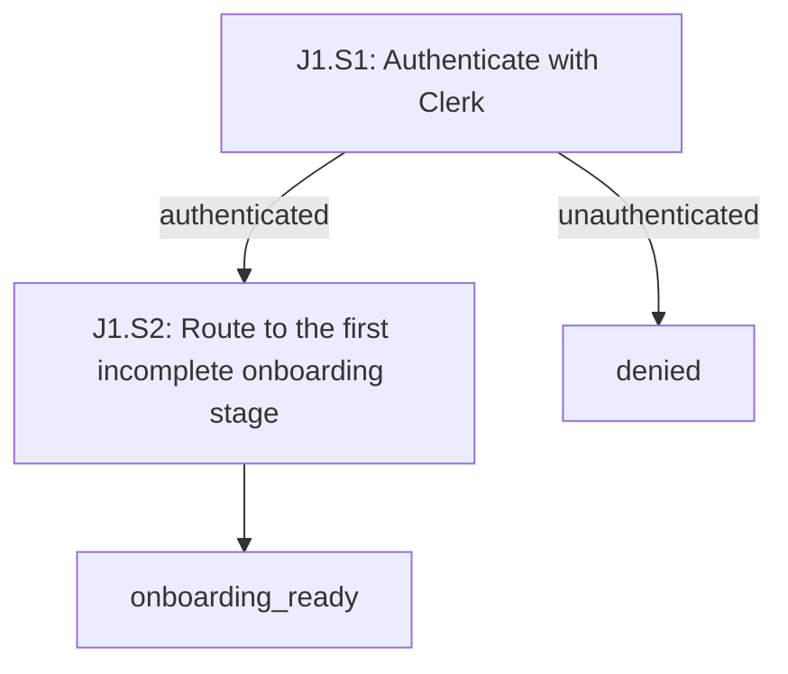
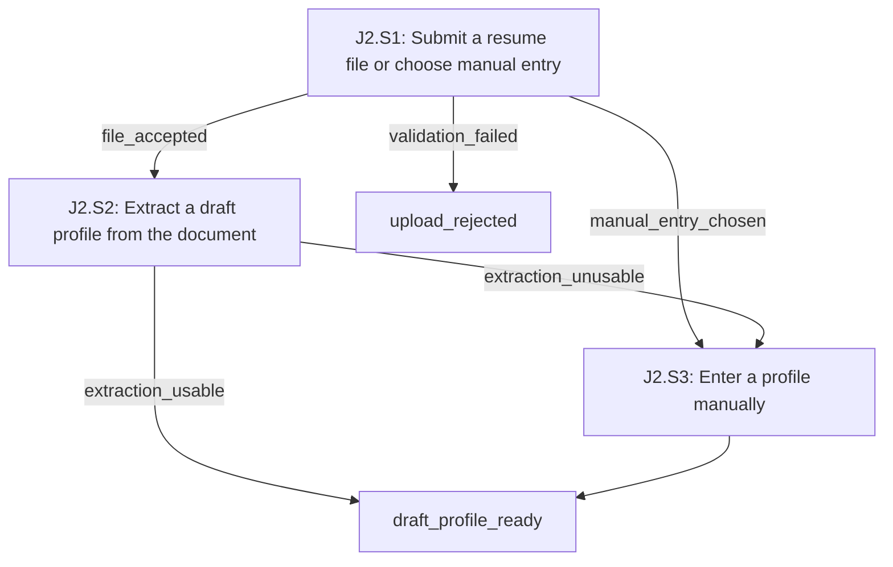
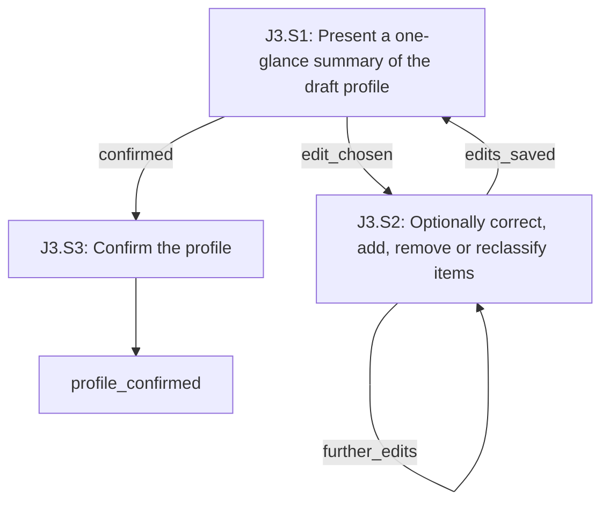
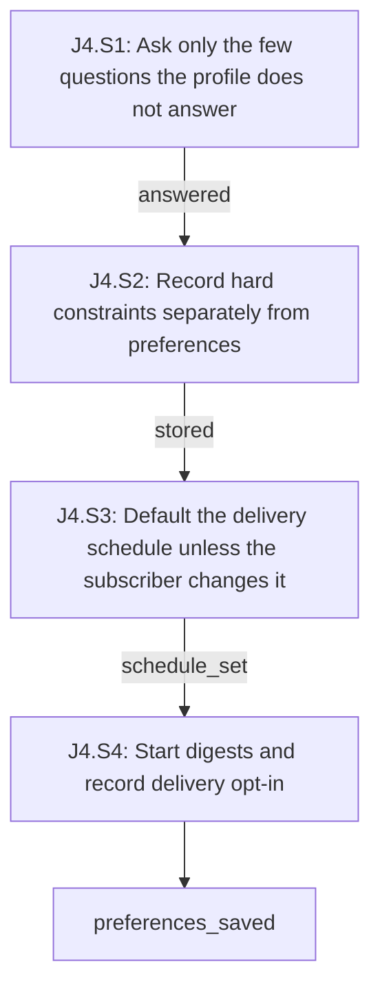
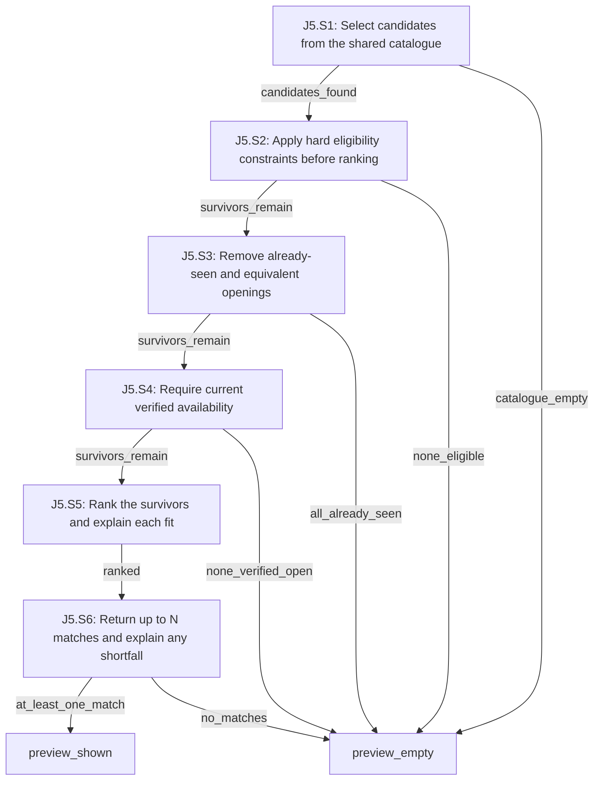
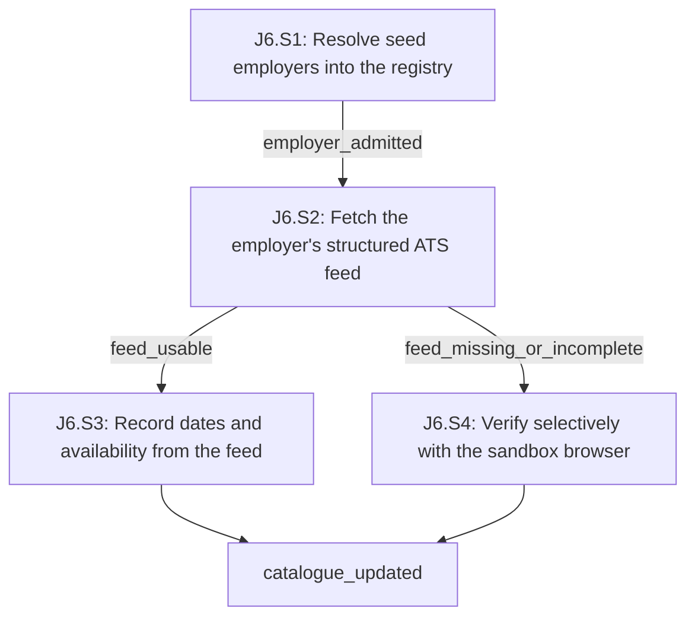
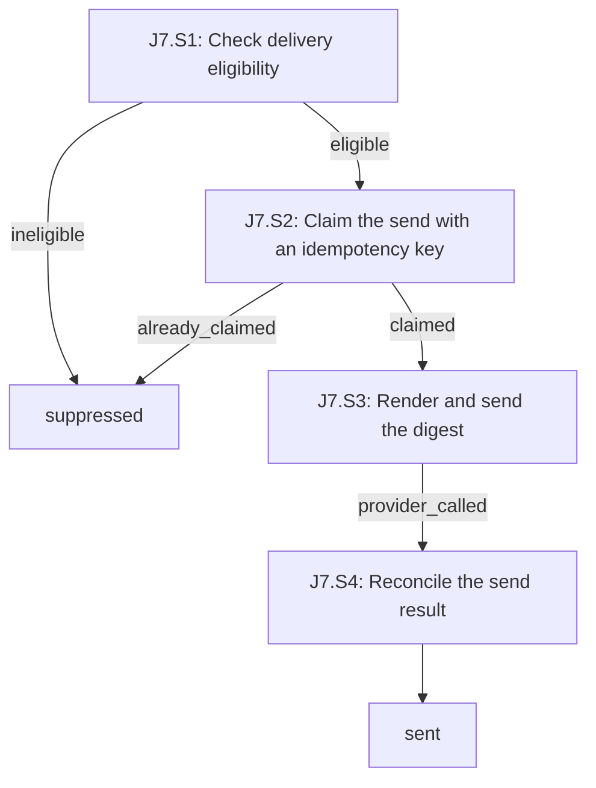

# onboarding-to-first-digest

<!-- Generated by journeys.ts; edit the YAML source. -->

Decisions: [source](../decisions.md)

## Observations

Descriptive evidence only. Observations are not approved decisions.

- **O1**: eve turns each defineSchedule into a Vercel Cron Job evaluated in UTC, fixed at build time, so a single authored cron cannot express per-subscriber local delivery times
  - Source: vercel/eve docs/schedules.mdx; revision: 7b8a520; location: On Vercel
- **O2**: The eve sandbox receives no process.env, no secrets and no path back to the app runtime; built-in tools execute in the app runtime and proxy into the sandbox
  - Source: vercel/eve docs/concepts/security-model.md; revision: 7b8a520; location: Trust boundaries
- **O3**: The agent-browser eve extension exposes browser__navigate, browser__snapshot, browser__click, browser__fill, browser__find and browser__screenshot, and accepts allowedDomains, contentBoundaries and maxOutputChars
  - Source: vercel/eve apps/docs/lib/integrations/data.ts; revision: 7b8a520; location: agent-browser
- **O4**: Greenhouse, Lever and Ashby each expose an unauthenticated per-employer job board feed with no server-side search, so filtering is client-side. Endpoint shapes are from secondary sources and are not yet verified against primary documentation
  - Source: https://github.com/Mersetti/ats-job-board-apis; revision: 2026-10-21; location: README endpoints
- **O5**: eve's documented application-managed scheduling pattern claims due rows under an atomic lease and states that delivery is at least once, so side-effecting work needs application-level idempotency
  - Source: vercel/eve docs/patterns/dynamic-scheduling.md; revision: 7b8a520; location: Delivery is at least once
- **O6**: Every eve session runs as one durable workflow checkpointed at step boundaries, surviving process restarts and redeploys
  - Source: vercel/eve docs/concepts/execution-model-and-durability.mdx; revision: 7b8a520; location: Sessions

## Coverage inventory

| ID | Actor goal | Status | Journeys / reason |
|---|---|---|---|
| C1 | subscriber: Sign in and reach the right onboarding stage | mapped | J1 |
| C2 | subscriber: Provide a resume or enter a profile manually | mapped | J2 |
| C3 | subscriber: Confirm the extracted profile at a glance | mapped | J3 |
| C4 | subscriber: Answer a few preference questions and start digests on a default schedule | mapped | J4 |
| C5 | subscriber: Preview an initial ranked digest immediately | mapped | J5 |
| C6 | operator: Build and verify the shared job catalogue from a seed employer set | mapped | J6 |
| C7 | subscriber: Receive a test email digest | mapped | J7 |
| C8 | subscriber: Resume onboarding after closing the tab or losing a response | mapped | J2, J3, J4 |
| C9 | subscriber: Receive digests automatically on a recurring schedule in their own timezone | unresolved | Deferred to stage 3. Policy is now accepted under D50, D74, D75 and D76; the journey is not yet mapped |
| C10 | subscriber: Pause, resume or unsubscribe from delivery | unresolved | Accepted as policy under D46 but not mapped in the thin flow. J7.S1 reads the states; the subscriber-facing controls arrive in stage 3 |
| C11 | subscriber: Mark a job interested, not relevant, already applied or already contacted | unresolved | Accepted as policy under D44 but deferred to stage 4. J5.S3 consumes these marks once they exist |
| C12 | subscriber: See a relevant verified hiring contact for a recommendation | unresolved | Deferred until verification and ranking are trustworthy under D73 |
| C13 | subscriber: Delete their account and stored data | unresolved | Retention is accepted under D59; the deletion journey is not yet mapped |
| C14 | operator: Expand employer coverage beyond the seed set | unresolved | Continuous discovery is a stage 1 goal under D61 and D63, with automated admission under D64 and a separate budget under D66. J6 must be extended to map it before stage 1 is ready |

Inventory completeness and the meaning of each mapping require review.

## Invariants

- **I1**: THE SYSTEM SHALL NOT present a job to a subscriber unless a recorded verification classified that opening verified_open (D7, D9, D48)
- **I2**: THE SYSTEM SHALL NOT include an opening already delivered to that subscriber, matched at the exact-opening level (D17)
- **I3**: THE SYSTEM SHALL NOT include a job that fails one of the subscriber's hard eligibility constraints (D13, D16, D42)
- **I4**: THE SYSTEM SHALL NOT attribute to a subscriber any experience or qualification absent from their confirmed profile (D28, D43)
- **I5**: THE SYSTEM SHALL NOT expose one subscriber's resume, profile or recommendations to another principal (D35)
- **I6**: THE SYSTEM SHALL NOT send email to a subscriber without a current opt-in and no active pause or unsubscribe (D22, D46)
- **I7**: THE SYSTEM SHALL NOT send more than one digest for the same send idempotency key (D22, D23)
- **I8**: THE SYSTEM SHALL NOT act on instructions found in an external page or an uploaded document (D32)
- **I9**: THE SYSTEM SHALL NOT perform a write action against an external site during research (D11, D12)

## J1: Sign in and reach onboarding

Actor: subscriber. Entry: J1.S1. Exits: onboarding_ready, denied.

| Step | Kind | Policy / observations | Invariants |
|---|---|---|---|
| J1.S1: Authenticate with Clerk | system | D1, D35, D95 | I5 |
| J1.S2: Route to the first incomplete onboarding stage | system | D105, D30 |  |

### J1.S1

Surface: web.

- **J1.S1.c1**: WHEN a visitor completes Clerk sign-in THE SYSTEM SHALL create or load the subscriber record keyed to the verified Clerk user id
- **J1.S1.c2**: IF a request carries no verified Clerk session THE SYSTEM SHALL NOT return any subscriber data
- **J1.S1.c3**: IF a request supplies a subscriber id that differs from the verified session principal THE SYSTEM SHALL NOT act on the supplied id
- **J1.S1.c4**: IF the identity provider is unavailable THE SYSTEM SHALL NOT create or modify a subscriber record
- **J1.S1.c5**: WHEN the identity provider is unavailable THE SYSTEM SHALL leave the visitor unauthenticated and offer a retry

### J1.S2

Surface: web.

- **J1.S2.c1**: WHEN a signed-in subscriber has no draft or confirmed profile THE SYSTEM SHALL route them to the resume stage
- **J1.S2.c2**: WHEN a signed-in subscriber has a draft profile that is not confirmed THE SYSTEM SHALL route them to the profile review stage
- **J1.S2.c3**: WHEN a signed-in subscriber has a confirmed profile and no saved preferences THE SYSTEM SHALL route them to the preferences stage

### Branch review

- **input**: covered; Sign-in input is handled by Clerk; the only application-side input is the session principal, which is read from the verified session (J1.S1.c1, J1.S1.c3)
- **permissions**: covered; Unauthenticated requests return no subscriber data and a client-supplied id is never trusted (J1.S1.c2, J1.S1.c3)
- **interruption**: covered; Onboarding stage is derived from persisted profile and preference state on every entry, so a closed tab resumes at the same stage (J1.S2.c1, J1.S2.c2, J1.S2.c3)
- **dependencies**: covered; Under D95 an unavailable identity provider leaves the visitor unauthenticated with a retry and writes no partial subscriber record (J1.S1.c4, J1.S1.c5)
- **duplicates**: covered; The subscriber record is keyed to the Clerk user id, so repeated sign-ins load rather than duplicate it (J1.S1.c1)
- **concurrency**: covered; Two concurrent first sign-ins for one Clerk user id resolve to one record because the key is unique (J1.S1.c1)
- **recovery**: covered; No durable side effect occurs before the subscriber record exists, and routing is recomputed from persisted state (J1.S2.c1)

## J2: Provide a resume

Actor: subscriber. Entry: J2.S1. Exits: draft_profile_ready, upload_rejected.

| Step | Kind | Policy / observations | Invariants |
|---|---|---|---|
| J2.S1: Submit a resume file or choose manual entry | human | D47, D35, D59, D95, D96 | I5 |
| J2.S2: Extract a draft profile from the document | system | D28, D32, D43, D95, D96, D97 | I4, I8 |
| J2.S3: Enter a profile manually | human | D28, D47 | I4 |

### J2.S1

Surface: web; state: resume_stage.

- **J2.S1.c1**: WHEN a subscriber uploads a PDF or DOCX within the configured size limit THE SYSTEM SHALL store it in private object storage scoped to that subscriber
- **J2.S1.c2**: IF an upload fails type or size validation THE SYSTEM SHALL NOT store the file
- **J2.S1.c3**: WHEN an upload fails validation THE SYSTEM SHALL offer manual entry as a fallback
- **J2.S1.c4**: IF a principal requests a stored resume they do not own THE SYSTEM SHALL NOT return it
- **J2.S1.c5**: IF object storage is unavailable or rejects the write THE SYSTEM SHALL NOT record the upload as stored
- **J2.S1.c6**: WHEN object storage is unavailable THE SYSTEM SHALL keep the subscriber at the resume stage and offer a retry
- **J2.S1.c7**: WHEN a subscriber uploads a replacement resume THE SYSTEM SHALL delete the previously stored upload and retain only the newest one

### J2.S2

- **J2.S2.c1**: WHEN extraction runs THE SYSTEM SHALL record for each extracted item the document location it came from
- **J2.S2.c2**: WHEN extraction runs THE SYSTEM SHALL separate professional experience from personal projects, demos and work in progress
- **J2.S2.c3**: IF the document contains text that instructs the agent THE SYSTEM SHALL NOT act on that text
- **J2.S2.c4**: IF an extracted claim has no supporting location in the document THE SYSTEM SHALL NOT include it in the draft profile
- **J2.S2.c5**: WHEN extraction yields no usable professional experience THE SYSTEM SHALL offer manual entry
- **J2.S2.c6**: IF the extraction model is unavailable or fails THE SYSTEM SHALL NOT write a partial draft profile
- **J2.S2.c7**: WHEN extraction fails THE SYSTEM SHALL keep the subscriber at the resume stage and offer a retry
- **J2.S2.c8**: WHEN a replacement upload is extracted THE SYSTEM SHALL replace the subscriber's existing draft profile rather than adding a second one
- **J2.S2.c9**: WHEN extraction begins THE SYSTEM SHALL claim the subscriber's draft profile as its single writer
- **J2.S2.c10**: IF another extraction holds that claim THE SYSTEM SHALL NOT write the draft profile

### J2.S3

Surface: web; state: manual_entry.

- **J2.S3.c1**: WHEN a subscriber submits the manual form THE SYSTEM SHALL build the draft profile from exactly those entries
- **J2.S3.c2**: IF a field is left empty THE SYSTEM SHALL NOT populate it with an inferred value
- **J2.S3.c3**: WHEN a subscriber enters an item THE SYSTEM SHALL require them to classify it as professional experience or as a personal project

### Branch review

- **input**: covered; Upload type and size are validated before storage, and manual entries are taken verbatim without inference (J2.S1.c2, J2.S3.c2)
- **permissions**: covered; Stored resumes are scoped to their owner and reads by other principals are refused (J2.S1.c1, J2.S1.c4)
- **interruption**: covered; The stored file and the draft profile are separate persisted artifacts, so an interrupted extraction leaves the upload intact and the subscriber can resubmit or switch to manual entry (J2.S1.c1, J2.S2.c5)
- **dependencies**: covered; Under D95 an unavailable object store or extraction model keeps the subscriber at the resume stage with a retry and persists neither a stored upload nor a partial draft profile (J2.S1.c5, J2.S1.c6, J2.S2.c6, J2.S2.c7)
- **duplicates**: covered; Under D96 a replacement upload deletes the previous file and replaces the one draft profile, which is also the minimal retention D59 requires (J2.S1.c7, J2.S2.c8)
- **concurrency**: covered; Under D97 extraction claims the draft profile as its single writer, so a concurrent extraction does not interleave items from two documents (J2.S2.c9, J2.S2.c10)
- **recovery**: covered; Manual entry is always reachable as a fallback from both a rejected upload and an unusable extraction (J2.S1.c3, J2.S2.c5)

## J3: Confirm the profile at a glance

Actor: subscriber. Entry: J3.S1. Exits: profile_confirmed.

| Step | Kind | Policy / observations | Invariants |
|---|---|---|---|
| J3.S1: Present a one-glance summary of the draft profile | system | D28, D35, D104, D105 | I4, I5 |
| J3.S2: Optionally correct, add, remove or reclassify items | human | D28, D98, D105 |  |
| J3.S3: Confirm the profile | system | D43, D105 | I4 |

### J3.S1

Surface: web; state: profile_review.

- **J3.S1.c1**: WHEN a draft profile is displayed THE SYSTEM SHALL mark each item as extracted from the document or manually entered
- **J3.S1.c2**: IF an item was not extracted from the document THE SYSTEM SHALL NOT label it as extracted
- **J3.S1.c3**: WHEN an item was extracted THE SYSTEM SHALL let the subscriber see the document location it came from
- **J3.S1.c4**: IF the requesting principal does not own the draft profile THE SYSTEM SHALL NOT display it
- **J3.S1.c5**: WHEN the draft profile is displayed THE SYSTEM SHALL summarise it on one screen with a single confirm action
- **J3.S1.c6**: IF the subscriber does not choose to edit THE SYSTEM SHALL NOT require them to review items one by one

### J3.S2

Surface: web; state: profile_review.

- **J3.S2.c1**: WHEN a subscriber edits an item THE SYSTEM SHALL persist that edit before advancing to the next stage
- **J3.S2.c2**: WHEN a subscriber moves an item between professional experience and personal projects THE SYSTEM SHALL store the new classification
- **J3.S2.c3**: WHEN a subscriber removes an item THE SYSTEM SHALL stop using it for matching
- **J3.S2.c4**: WHEN a subscriber submits an edit THE SYSTEM SHALL require the item version that edit was based on
- **J3.S2.c5**: IF the submitted item version is stale THE SYSTEM SHALL NOT apply that edit
- **J3.S2.c6**: WHEN an edit is refused as stale THE SYSTEM SHALL tell that writer to reload the item before editing it again

### J3.S3

- **J3.S3.c1**: WHEN a subscriber confirms THE SYSTEM SHALL record the confirmed profile with its confirmation timestamp
- **J3.S3.c2**: IF a profile has not been confirmed THE SYSTEM SHALL NOT use it to generate recommendations
- **J3.S3.c3**: WHEN a confirmed profile is later edited THE SYSTEM SHALL require confirmation again before the next digest

### Branch review

- **input**: covered; Edits are persisted as submitted and removals take effect on matching without inference (J3.S2.c1, J3.S2.c3)
- **permissions**: covered; The draft profile is displayed only to the principal that owns it (J3.S1.c4)
- **interruption**: covered; Each edit is persisted before the stage advances, and an unconfirmed profile cannot be used for recommendations (J3.S2.c1, J3.S3.c2)
- **dependencies**: not-applicable; The step reads and writes only the application's own persisted profile rows and calls no external service
- **duplicates**: covered; Repeated confirmation records the same confirmed profile and its timestamp rather than creating a second profile (J3.S3.c1)
- **concurrency**: covered; Under D98 each edit carries the item version it was based on, so a stale edit is refused and its writer is told to reload rather than silently overwriting a correction (J3.S2.c4, J3.S2.c5, J3.S2.c6)
- **recovery**: covered; An unconfirmed profile cannot be used for recommendations, and a later edit re-requires confirmation (J3.S3.c2, J3.S3.c3)

## J4: Answer a few questions and start digests

Actor: subscriber. Entry: J4.S1. Exits: preferences_saved.

| Step | Kind | Policy / observations | Invariants |
|---|---|---|---|
| J4.S1: Ask only the few questions the profile does not answer | system | D30, D35, D53, D104, D106 | I5 |
| J4.S2: Record hard constraints separately from preferences | system | D13, D16, D42 | I3 |
| J4.S3: Default the delivery schedule unless the subscriber changes it | system | D15, D19, D69, D76, D106 |  |
| J4.S4: Start digests and record delivery opt-in | system | D22, D46, D99, D106 | I6 |

### J4.S1

Surface: web; state: preferences.

- **J4.S1.c1**: WHEN the question set is built THE SYSTEM SHALL omit questions already answered by the confirmed profile or a previous answer
- **J4.S1.c2**: WHEN a subscriber selects their target job families THE SYSTEM SHALL present only the question branches belonging to those families
- **J4.S1.c3**: IF the subscriber selects no job family THE SYSTEM SHALL NOT advance to the next stage
- **J4.S1.c4**: IF the requesting principal does not own the preferences THE SYSTEM SHALL NOT return or modify them
- **J4.S1.c5**: WHEN the question set is built THE SYSTEM SHALL require answers only to job family and to hard constraints the confirmed profile does not settle
- **J4.S1.c6**: WHEN a ranking preference can be inferred from the confirmed profile THE SYSTEM SHALL prefill it
- **J4.S1.c7**: IF a ranking preference is unanswered THE SYSTEM SHALL NOT block the subscriber from advancing

### J4.S2

- **J4.S2.c1**: WHEN work authorisation, sponsorship requirement, country eligibility and exclusions are answered THE SYSTEM SHALL store them as hard constraints
- **J4.S2.c2**: WHEN target roles, seniority, industries, company stages and compensation expectations are answered THE SYSTEM SHALL store them as ranking preferences
- **J4.S2.c3**: IF a hard constraint answer is unknown THE SYSTEM SHALL NOT store it as satisfied
- **J4.S2.c4**: WHEN a remote preference is recorded THE SYSTEM SHALL keep any geographic restriction as a hard constraint rather than a preference

### J4.S3

Surface: web; state: preferences.

- **J4.S3.c1**: WHEN no digest size is chosen THE SYSTEM SHALL default it to 10
- **J4.S3.c2**: WHEN a delivery time is chosen THE SYSTEM SHALL store the local time of day and a separate IANA timezone identifier
- **J4.S3.c3**: IF a submitted timezone is not a recognised IANA identifier THE SYSTEM SHALL NOT save the schedule
- **J4.S3.c4**: IF a submitted digest size falls outside 3 to 20 THE SYSTEM SHALL NOT save the schedule
- **J4.S3.c5**: WHEN delivery days are chosen THE SYSTEM SHALL store them as a set of weekdays evaluated in the subscriber's timezone
- **J4.S3.c6**: IF no delivery day is selected THE SYSTEM SHALL NOT save the schedule
- **J4.S3.c7**: WHEN no delivery days are chosen THE SYSTEM SHALL default them to every day
- **J4.S3.c8**: WHEN no delivery time is chosen THE SYSTEM SHALL default it to 08:00 in the subscriber's timezone
- **J4.S3.c9**: WHEN the browser reports a recognised IANA timezone THE SYSTEM SHALL use it as the subscriber's timezone without asking
- **J4.S3.c10**: IF the browser reports no timezone or an unrecognised one THE SYSTEM SHALL NOT save the schedule until the subscriber picks a timezone
- **J4.S3.c11**: IF a schedule setting has a default THE SYSTEM SHALL NOT require the subscriber to answer it during onboarding

### J4.S4

- **J4.S4.c1**: WHEN preferences are saved THE SYSTEM SHALL record an explicit delivery opt-in with its timestamp
- **J4.S4.c2**: IF a subscriber has not given an explicit opt-in THE SYSTEM SHALL NOT mark them eligible for delivery
- **J4.S4.c3**: WHEN preferences are saved THE SYSTEM SHALL make them editable without repeating onboarding
- **J4.S4.c4**: WHEN preferences are saved THE SYSTEM SHALL apply the constraint, schedule and opt-in changes to one preference row in a single transaction
- **J4.S4.c5**: IF a concurrent save is in progress THE SYSTEM SHALL NOT persist a combination of the two that neither save submitted
- **J4.S4.c6**: WHEN the start action is shown THE SYSTEM SHALL display the delivery schedule and digest size it will use with a way to change them
- **J4.S4.c7**: WHEN the subscriber takes the start action THE SYSTEM SHALL record it as the explicit delivery opt-in

### Branch review

- **input**: covered; Timezone, digest size and job-family selection are validated and rejected rather than coerced (J4.S1.c3, J4.S3.c3, J4.S3.c4)
- **permissions**: covered; Preferences are returned and modified only for the principal that owns them (J4.S1.c4)
- **interruption**: covered; Preferences are saved as one record and the opt-in is written with it, so an interrupted run leaves the subscriber ineligible for delivery rather than half-subscribed (J4.S4.c1, J4.S4.c2)
- **dependencies**: not-applicable; The step reads and writes only the application's own persisted preference rows and calls no external service
- **duplicates**: covered; Saving preferences again updates the one preference record and its opt-in timestamp rather than creating a second subscription (J4.S4.c1, J4.S4.c3)
- **concurrency**: covered; Under D99 constraints, schedule and opt-in are written to one preference row in a single transaction, so no save persists a combination neither writer submitted (J4.S4.c4, J4.S4.c5)
- **recovery**: covered; Delivery eligibility requires an explicit opt-in, so an incomplete run leaves nothing scheduled, and preferences stay editable afterwards (J4.S4.c2, J4.S4.c3)

## J5: Generate a ranked preview digest

Actor: subscriber. Entry: J5.S1. Exits: preview_shown, preview_empty.

| Step | Kind | Policy / observations | Invariants |
|---|---|---|---|
| J5.S1: Select candidates from the shared catalogue | system | D4, D37, D100 | I5 |
| J5.S2: Apply hard eligibility constraints before ranking | system | D13, D16, D42 | I3 |
| J5.S3: Remove already-seen and equivalent openings | system | D17, D18 | I2 |
| J5.S4: Require current verified availability | system | D7, D9, D48, D101 | I1 |
| J5.S5: Rank the survivors and explain each fit | system | D40, D41, D43 | I4 |
| J5.S6: Return up to N matches and explain any shortfall | system | D14, D38, D49 | I1, I2, I3 |

### J5.S1

- **J5.S1.c1**: WHEN a preview is requested THE SYSTEM SHALL read candidate openings from the shared catalogue rather than researching per subscriber
- **J5.S1.c2**: IF a row holds another subscriber's private profile or recommendation data THE SYSTEM SHALL NOT read it into this preview
- **J5.S1.c3**: WHEN the catalogue holds no openings for the subscriber's job families THE SYSTEM SHALL record that as the shortfall reason
- **J5.S1.c4**: IF a preview run is interrupted before it returns THE SYSTEM SHALL NOT resume that run
- **J5.S1.c5**: WHEN a preview is requested after an interrupted run THE SYSTEM SHALL recompute it from the catalogue and the confirmed profile

### J5.S2

- **J5.S2.c1**: WHEN filtering runs THE SYSTEM SHALL remove every opening that fails a hard constraint before any ranking occurs
- **J5.S2.c2**: IF an opening's sponsorship, salary or country eligibility is unknown THE SYSTEM SHALL NOT treat the affected constraint as satisfied
- **J5.S2.c3**: WHEN an opening is marked remote THE SYSTEM SHALL apply its stated geographic restriction rather than treating remote as worldwide

### J5.S3

- **J5.S3.c1**: WHEN exclusion runs THE SYSTEM SHALL remove openings already delivered to this subscriber, matched at the exact-opening level
- **J5.S3.c2**: WHEN two listings describe one opening found through different sources THE SYSTEM SHALL collapse them into a single candidate
- **J5.S3.c3**: IF the subscriber recorded an application against a different opening at the same employer THE SYSTEM SHALL NOT exclude this opening
- **J5.S3.c4**: WHEN an opening is a different requisition or a reopened role THE SYSTEM SHALL label it as such rather than suppressing it

### J5.S4

- **J5.S4.c1**: WHEN a candidate's last verification is older than the configured freshness window THE SYSTEM SHALL revalidate it before including it
- **J5.S4.c2**: IF a candidate is not classified verified_open THE SYSTEM SHALL NOT include it in the preview
- **J5.S4.c3**: WHEN revalidation is inconclusive THE SYSTEM SHALL classify the candidate uncertain and record the observed failure
- **J5.S4.c4**: WHEN a verification result is produced THE SYSTEM SHALL cache it against the opening so other subscribers reuse it
- **J5.S4.c5**: WHEN a candidate needs revalidation THE SYSTEM SHALL acquire that opening's verification lease before verifying it
- **J5.S4.c6**: IF another run holds that opening's verification lease THE SYSTEM SHALL NOT start a second verification of it
- **J5.S4.c7**: WHEN a verification held elsewhere resolves THE SYSTEM SHALL read the cached result rather than producing its own

### J5.S5

- **J5.S5.c1**: WHEN assessing relevance THE SYSTEM SHALL read the opening's responsibilities, stack, seniority and domain rather than inferring them from its title
- **J5.S5.c2**: WHEN an explanation is produced THE SYSTEM SHALL ground every candidate-side claim in the confirmed profile
- **J5.S5.c3**: IF a fit claim is not supported by the confirmed profile THE SYSTEM SHALL NOT include that claim in the explanation
- **J5.S5.c4**: WHEN material gaps or constraints exist THE SYSTEM SHALL state them alongside the fit explanation
- **J5.S5.c5**: WHEN model output fails structured validation THE SYSTEM SHALL drop that candidate rather than presenting unvalidated text

### J5.S6

Surface: web.

- **J5.S6.c1**: WHEN fewer than the requested number of matches survive THE SYSTEM SHALL return only the survivors and state why the count is short
- **J5.S6.c2**: IF fewer than the requested number survive THE SYSTEM SHALL NOT add an opening that failed availability, eligibility or exclusion in order to reach the requested count
- **J5.S6.c3**: WHEN any displayed opening derives from mock data THE SYSTEM SHALL label it as mock rather than verified
- **J5.S6.c4**: WHEN a verified opening is displayed THE SYSTEM SHALL NOT present it as a guarantee of interview or hire

### Branch review

- **input**: covered; Candidates come from the shared catalogue rather than from request input, and model output that fails structured validation is dropped instead of displayed (J5.S1.c1, J5.S5.c5)
- **permissions**: covered; Private rows belonging to other subscribers are never read into a preview, while public catalogue rows are shared by design (J5.S1.c1, J5.S1.c2)
- **interruption**: covered; Under D100 an interrupted preview is recomputed rather than resumed, which is safe because a preview writes no delivery history, and the cached verification results keep the recomputation cheap (J5.S1.c4, J5.S1.c5, J5.S4.c4)
- **dependencies**: covered; An inconclusive revalidation yields the uncertain state and excludes the candidate instead of failing the preview or assuming closure (J5.S4.c2, J5.S4.c3)
- **duplicates**: covered; Equivalent listings of one opening collapse to a single candidate and already-delivered openings are excluded at the exact-opening level (J5.S3.c1, J5.S3.c2)
- **concurrency**: covered; Under D101 revalidation takes a per-opening lease, so a second concurrent preview reads the cached result instead of verifying the same opening again (J5.S4.c5, J5.S4.c6, J5.S4.c7)
- **recovery**: covered; Every exhausted filter path reaches preview_empty with a recorded shortfall reason rather than an empty screen or a padded list (J5.S1.c3, J5.S6.c1, J5.S6.c2)

## J6: Build the verified job catalogue

Actor: operator. Entry: J6.S1. Exits: catalogue_updated.

| Step | Kind | Policy / observations | Invariants |
|---|---|---|---|
| J6.S1: Resolve seed employers into the registry | system | D5, D55 |  |
| J6.S2: Fetch the employer's structured ATS feed | external | D6, D7, D36, D102; observed: O4 |  |
| J6.S3: Record dates and availability from the feed | system | D9, D10 | I1 |
| J6.S4: Verify selectively with the sandbox browser | system | D3, D8, D11, D12, D33, D34, D36, D101; observed: O2, O3 | I1, I8, I9 |

### J6.S1

- **J6.S1.c1**: WHEN an employer is admitted THE SYSTEM SHALL record its verified identity, website, careers page and ATS board
- **J6.S1.c2**: IF two companies share a name THE SYSTEM SHALL NOT merge them into one registry entry
- **J6.S1.c3**: IF an addition would take the registry past the configured employer cap THE SYSTEM SHALL NOT admit it
- **J6.S1.c4**: WHEN an employer's ATS board cannot be confirmed from its own careers page THE SYSTEM SHALL leave the employer pending rather than admitted

### J6.S2

- **J6.S2.c1**: WHEN an employer has a Greenhouse, Lever or Ashby board THE SYSTEM SHALL fetch that employer's own public feed rather than an aggregator
- **J6.S2.c2**: IF a feed request fails or returns no listings THE SYSTEM SHALL NOT mark that employer's existing openings closed
- **J6.S2.c3**: WHEN a feed responds THE SYSTEM SHALL record the canonical URL, source URL, requisition id and relevant description for each listing
- **J6.S2.c4**: IF a listing is known only from a directory or aggregator THE SYSTEM SHALL NOT classify it verified_open
- **J6.S2.c5**: WHEN the configured request budget for a run is exhausted THE SYSTEM SHALL stop fetching and record the run as partial
- **J6.S2.c6**: WHEN a run is recorded partial THE SYSTEM SHALL record the employer cursor it reached
- **J6.S2.c7**: WHEN a run starts after a partial run THE SYSTEM SHALL resume at the first employer not yet fetched rather than refetching the employers already recorded

### J6.S3

- **J6.S3.c1**: WHEN a listing is recorded THE SYSTEM SHALL keep its original publication date, update date, first-seen date and last-verification time as four distinct fields
- **J6.S3.c2**: IF a listing's update date changes while its requisition id does not THE SYSTEM SHALL NOT record it as a new vacancy
- **J6.S3.c3**: IF availability cannot be established from the feed THE SYSTEM SHALL NOT classify the listing verified_open
- **J6.S3.c4**: WHEN a previously listed opening is absent from a successful full feed response THE SYSTEM SHALL classify it confirmed_closed

### J6.S4

- **J6.S4.c1**: WHEN simpler retrieval returns incomplete content or a JavaScript shell THE SYSTEM SHALL inspect the official board in the sandbox browser
- **J6.S4.c2**: WHEN the browser inspects a board or listing THE SYSTEM SHALL record which URLs were actually loaded and what was observed
- **J6.S4.c3**: WHEN an Apply link is followed THE SYSTEM SHALL record whether an application form, a login requirement or a closure notice was present
- **J6.S4.c4**: IF only an Apply button is observed THE SYSTEM SHALL NOT classify the listing verified_open
- **J6.S4.c5**: IF a fetched page contains text that instructs the agent THE SYSTEM SHALL NOT act on it
- **J6.S4.c6**: IF an action would submit a form, upload a file, create an account or contact an employer THE SYSTEM SHALL NOT perform it
- **J6.S4.c7**: IF the browser receives a timeout, a 403, a CAPTCHA, a blank page or a single 404 THE SYSTEM SHALL NOT classify the listing confirmed_closed
- **J6.S4.c8**: IF a destination is outside the configured domain allow list or resolves to a private address THE SYSTEM SHALL NOT navigate to it
- **J6.S4.c9**: WHEN the configured page, runtime or browser-session budget is reached THE SYSTEM SHALL stop and record the outcome as uncertain
- **J6.S4.c10**: WHEN an ATS migration or changed URL is detected THE SYSTEM SHALL record the new location against the same opening
- **J6.S4.c11**: WHEN an opening needs browser verification THE SYSTEM SHALL acquire that opening's verification lease, the same lease preview verification uses
- **J6.S4.c12**: IF another run holds that opening's verification lease THE SYSTEM SHALL NOT spend browser budget verifying it again

### Branch review

- **input**: covered; Feed and page content is treated as untrusted data, never as instruction, and only an owner-seeded employer with a confirmed board is admitted (J6.S1.c4, J6.S4.c5)
- **permissions**: covered; Research is read-only, destinations are allow-listed, private addresses are refused, and no external write action is permitted (J6.S4.c6, J6.S4.c8)
- **interruption**: covered; An exhausted budget records the run as partial or the outcome as uncertain instead of leaving openings implicitly closed (J6.S2.c5, J6.S4.c9)
- **dependencies**: covered; Feed failures, blocks and ambiguous pages never produce a closure, and migrations are recorded against the same opening (J6.S2.c2, J6.S4.c7, J6.S4.c10)
- **duplicates**: covered; A refreshed update date on an unchanged requisition id does not create a second vacancy (J6.S3.c2)
- **concurrency**: covered; Under D101 catalogue verification takes the same per-opening lease that preview verification uses, so one opening is not verified twice out of the browser budget (J6.S4.c11, J6.S4.c12)
- **recovery**: covered; Under D102 a partial run records the employer cursor it reached and the next run resumes there, so the request budget is not re-spent on employers already recorded (J6.S2.c5, J6.S2.c6, J6.S2.c7)

## J7: Send a test email digest

Actor: subscriber. Entry: J7.S1. Exits: sent, suppressed.

| Step | Kind | Policy / observations | Invariants |
|---|---|---|---|
| J7.S1: Check delivery eligibility | system | D22, D46 | I5, I6 |
| J7.S2: Claim the send with an idempotency key | system | D22, D23; observed: O5 | I7 |
| J7.S3: Render and send the digest | system | D24, D38, D40, D49, D52 |  |
| J7.S4: Reconcile the send result | system | D22, D23, D74, D103; observed: O5 | I7 |

### J7.S1

- **J7.S1.c1**: WHEN a send is requested THE SYSTEM SHALL check the current opt-in, pause and unsubscribe state before preparing the message
- **J7.S1.c2**: IF the subscriber is not opted in, is paused or has unsubscribed THE SYSTEM SHALL NOT send
- **J7.S1.c3**: IF the recipient address does not match the verified address of the authenticated subscriber THE SYSTEM SHALL NOT send

### J7.S2

- **J7.S2.c1**: WHEN a digest is prepared THE SYSTEM SHALL derive an idempotency key from the subscriber and the digest identity and persist a send record before calling the provider
- **J7.S2.c2**: IF a send record for that key already exists in a sent or in-flight state THE SYSTEM SHALL NOT call the provider again
- **J7.S2.c3**: WHEN a send record is claimed THE SYSTEM SHALL store the exact openings the digest will contain

### J7.S3

- **J7.S3.c1**: WHEN the digest renders THE SYSTEM SHALL include for each opening the company, the role, the direct application URL, the fit explanation, the material gaps and constraints, the published compensation or undisclosed, the location and remote restrictions, the sponsorship evidence or its uncertainty, the supporting sources and the last-verification date
- **J7.S3.c2**: WHEN the digest renders THE SYSTEM SHALL read persisted recommendation rows rather than calling a model at send time
- **J7.S3.c3**: WHEN the digest contains mock data THE SYSTEM SHALL label it as mock
- **J7.S3.c4**: IF a recipient clicks an application link THE SYSTEM SHALL NOT record an application as submitted

### J7.S4

- **J7.S4.c1**: WHEN the provider confirms acceptance THE SYSTEM SHALL mark the send record sent and store the provider message id
- **J7.S4.c2**: WHEN the provider result is unknown THE SYSTEM SHALL mark the send record uncertain
- **J7.S4.c3**: IF a send record is uncertain THE SYSTEM SHALL NOT retry it before reconciling against the provider
- **J7.S4.c4**: WHEN a digest is recorded sent THE SYSTEM SHALL add each included opening to the subscriber's delivery history
- **J7.S4.c5**: WHEN reconciliation records a send as not delivered and the delivery grace window has not elapsed THE SYSTEM SHALL retry it under the same idempotency key
- **J7.S4.c6**: IF the delivery grace window has elapsed THE SYSTEM SHALL NOT retry the send
- **J7.S4.c7**: WHEN a send is abandoned after the grace window THE SYSTEM SHALL mark the record abandoned and fold its openings into the next scheduled digest

### Branch review

- **input**: covered; The recipient is taken from the verified subscriber record rather than from the request, and the digest body is rendered from persisted rows (J7.S1.c3, J7.S3.c2)
- **permissions**: covered; Opt-in, pause and unsubscribe state is checked before the message is prepared, and a mismatched recipient is refused (J7.S1.c2, J7.S1.c3)
- **interruption**: covered; The send record is persisted before the provider call, so a crash between the two leaves an in-flight record that reconciliation resolves rather than a silent double send (J7.S2.c1, J7.S4.c2, J7.S4.c3)
- **dependencies**: covered; An unknown provider result becomes the uncertain state and blocks retry until reconciliation (J7.S4.c2, J7.S4.c3)
- **duplicates**: covered; A second send for an existing key never reaches the provider, which is what makes the at-least-once dispatch of O5 safe (J7.S2.c2)
- **concurrency**: covered; The idempotency key is persisted as the claim, so two concurrent sends resolve to one provider call and the loser exits suppressed (J7.S2.c1, J7.S2.c2)
- **recovery**: covered; Under D103 an uncertain send is reconciled first, retried under the same idempotency key while the D74 grace window holds, then abandoned with its openings folded into the next scheduled digest (J7.S4.c3, J7.S4.c5, J7.S4.c6, J7.S4.c7)

Retired IDs: none.
